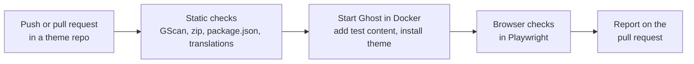

# Theme QA

Shared quality checks for the open-source Ghost themes made by
[Magic Pages](https://www.magicpages.co).

> **Status: early development.** This README describes what we're building.
> [Pod](https://github.com/magicpages/pod) is the first theme to use it;
> Vienna, Berlin, Kyiv and Alpine follow.

## Why this exists

We're open-sourcing our themes. That means more people change them, and more
people run them on sites that matter to them. Every theme should get the same
checks, on every push, no matter who opened the pull request.

Ghost's own tooling stops at [GScan](https://github.com/TryGhost/gscan): it
tells you whether a theme *can* be activated, not whether it *works*. Theme QA
fills that gap. It starts a real Ghost site in Docker, fills it with test
content, installs the theme, and checks the result in a real browser.

One repo holds the checks. Each theme repo turns them on with a few lines of
configuration, so a fix to a check reaches every theme at once.

## How it works



The same command runs on your machine and in CI, so a failing check can be
reproduced locally with one command.

## What it checks

| Check | What it catches |
|---|---|
| GScan, strict | Errors **and** warnings, on the source folder and on the release zip. Ghost itself only blocks on fatal errors; warnings become next year's errors. |
| Release zip | `node_modules`, `.git`, symlinks or source maps that slipped into the zip customers upload. |
| `package.json` | Missing `author.email`, untested `engines.ghost`, more than 20 custom settings, renamed setting keys (a renamed key silently wipes a customer's saved value). |
| Translations | Keys present in `en.json` but missing in another locale. |
| Pages load | Every template answers with the right status code: home, post, page, tag, author, pagination, 404, plus the theme's own routes. |
| Console and network | JavaScript errors, theme assets that 404, libraries loaded from third-party CDNs. |
| Layout | Pages that scroll sideways at phone, tablet or desktop width, with the elements sticking out. |
| Accessibility | [axe](https://github.com/dequelabs/axe-core) violations rated critical or serious, in light and dark mode. Keyboard basics: skip link, visible focus, menus that open and close with the keyboard. |
| Performance | [Lighthouse](https://github.com/GoogleChrome/lighthouse) scores for the homepage and a post, against a budget per theme. |
| Screenshots | Every template at phone, tablet and desktop widths, in light and dark mode. Compared against approved screenshots, so layout changes show up in review. |

Problems inside what Ghost renders itself (Portal, search, comments, the
markup of editor cards) don't fail a theme. They're listed as ignored in the
output, so nothing is hidden.

Automated checks don't replace a person. Real phones, screen readers, paid
member signups through Stripe and design review stay manual.

## Test content

A theme is only as tested as the content it's tested with. Test content comes
in three layers:

1. **Base content, shared by every theme.** Every editor card, very long and
   very short titles, right-to-left and CJK text, posts without images, authors
   without bios, members-only and paid-only posts, and enough posts to test
   pagination. A theme can switch off parts it doesn't support.
2. **Theme content, defined in the theme repo.** Whatever the theme needs that
   no other theme does. Pod needs podcast episodes with audio, a `#podcast`
   tag and its `routes.yaml`. Kyiv's homepage builds sections from pages tagged
   `#features` and `#testimonials`.
3. **Profiles.** Different combinations of custom settings. All browser checks
   run once per profile, plus once against a site with no posts to test empty
   states.

Test content is created by a script through Ghost's Admin API, not imported
from an export file. Scripts keep working when Ghost changes its export format,
and changes to them are easy to review.

## Using it in a theme

Add a config file to the theme repo. Every key is optional; without a file the
theme gets the base content, one profile and the standard pages.

```js
// theme-qa.config.mjs
export default {
  routes: 'routes.yaml',

  // Theme content, on top of the shared base content.
  async seed({ page }) {
    await page({ title: 'Fast by default', tags: ['#features'] });
    await page({ title: 'What readers say', tags: ['#testimonials'] });
  },

  // Each profile is a set of custom settings. Checks run once per profile.
  profiles: {
    default: {},
    'share-buttons-off': { custom: { enable_share_buttons: false } },
  },

  // URLs to check on top of the standard templates.
  urls: ['/features/'],
};
```

| Key | What it does |
|---|---|
| `routes` | `routes.yaml` to upload before seeding. |
| `seed(ctx)` | Adds theme content. `ctx` has `post`, `page`, `tag`, `upload`, `settings`, `custom`, `url`, editor `cards` and the shared `media` (images, audio, video). |
| `base.exclude` | Base content groups to leave out: `cards`, `typography`, `titles`, `images`, `i18n`, `authors`, `tags`, `visibility`, `pagination`. |
| `profiles` | Named sets of `custom` theme settings, site `settings` and an optional fixed `colorScheme`. Without `colorScheme`, pages are checked in light and dark mode. |
| `urls` | Extra paths, as strings or `{ path, status, screenshot, lighthouse, empty }`. |
| `ignore` | `console` and `requests` patterns and `axe` rule ids to skip. Every skip is printed, so nothing is hidden. |
| `budgets` | Minimum Lighthouse scores per category, 0 to 1. |
| `screenshots` | `viewports`, `mask` selectors and the `dir` for approved screenshots (default `qa/screenshots`). |
| `build`, `zip` | Commands to build and package the theme. Default: the theme's `build` and `zip` scripts. |

Theme-specific tests go in `qa/*.spec.mjs` and run next to the shared ones:

```js
import { test, expect } from '@magicpages/theme-qa/test';

test('the podcast feed lists every episode', async ({ request, manifest }) => {
  const response = await request.get(`${manifest.url}/podcast/rss/`);
  expect(response.status()).toBe(200);
});
```

Call the shared workflow from the theme's CI:

```yaml
# .github/workflows/qa.yml
name: QA
on:
  push:
    branches: [main]
  pull_request:

jobs:
  qa:
    uses: magicpages/theme-qa/.github/workflows/theme.yml@v1
```

Run the same checks locally (needs Docker and Node 22):

```bash
npx @magicpages/theme-qa run
```

| Command | What it does |
|---|---|
| `check` | Builds and zips the theme, runs the static checks. No Docker needed. |
| `up` | Starts Ghost on port 2399 with the theme and test content, and leaves it running. |
| `test` | Runs the browser checks against the running Ghost. |
| `down` | Removes the Ghost container. |
| `run` | All of the above, on an empty site and then a seeded one. What CI runs. |

New screenshots are saved the first time and pass. Commit them to approve
them. After an intended design change, run `test --update-screenshots` and
commit the new versions. In CI, new and failing screenshots are in the
`theme-qa-results` artifact.

## Ghost versions

Each run tests against the latest Ghost 6 release. The oldest version a theme
claims to support in `engines.ghost` gets a shorter smoke test, so we never
promise compatibility we haven't checked.

## Themes

| Theme | Repository | Using Theme QA |
|---|---|---|
| Pod | [magicpages/pod](https://github.com/magicpages/pod) | In progress |
| Vienna | Not public yet | Planned |
| Berlin | Not public yet | Planned |
| Kyiv | Not public yet | Planned |
| Alpine | Not public yet | Planned |

Built a Ghost theme yourself? The checks aren't tied to our themes. Once the
first version ships, any theme repo can call the workflow.

## License

[MIT](./LICENSE) © Magic Pages

Ghost® is a registered trademark of the Ghost Foundation. Theme QA is not
affiliated with or endorsed by the Ghost Foundation.
